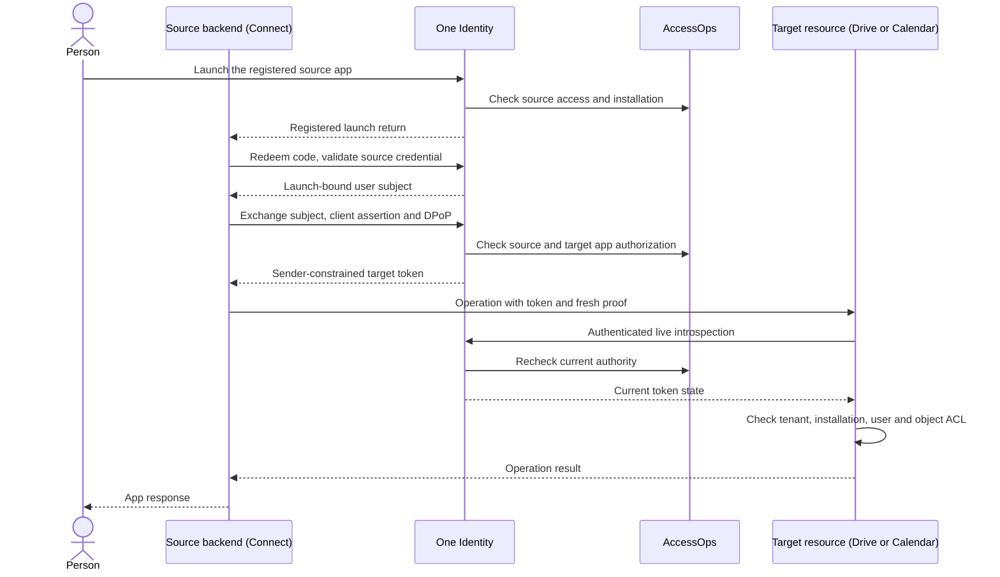

# One authentication and delegation architecture

The source backend continues a verified One login for its own installed first-party app. It uses the One-held launch binding to acquire a short-lived subject. When a user action needs another app, One exchanges the subject for an audience- and scope-limited token bound to a proof key held by the source backend. The target verifies the token and proof, introspects it with One, then resolves the canonical identity and installation to its own account and checks the object ACL. Identity and AccessOps retain responsibility for source and target application authorization.

## Reuse decisions

| Existing implementation | Use in this SDK |
| --- | --- |
| One Identity delegation routes, runtime, registry and service | Existing API and only issuance and application authorization path. The SDK makes authenticated requests to One. |
| One `delegation/profile.ts` and `delegation/resource-verifier.ts` | Byte-for-byte portable upstream files with checksums in the source manifest. The resource wrapper supplies the platform-specific key lookup, replay store, live introspection and ACL interfaces. Synchronize upstream changes as reviewed releases. |
| One `delegation/client.ts` and the equivalent Grid/Drive client | Source for the assertion, proof and exchange wire patterns. v0.2.0 factors the source and resource operations into one client and preserves structured failures. Migrate copies incrementally after acceptance. |
| v0.1.1 first-party SDK | Preserve `checkApplicationAccess`, `applicationAuthorizationEnabled`, `configuredInstallation`, error/type exports and Ed25519 product-evaluate behavior. One delegation and its optional launch evaluation call the same central authority. |
| `@cynayd/contracts` | Reuse the understanding of canonical app keys and connector contracts during onboarding. Delegation scopes and audiences come from the One registry. The gateway catalog uses different scope syntax in some cases. |
| Docs-to-Drive handoff | Reuse the source validation response, fixed lifetime and explicit reconnect contract. The handoff demonstrated One service configuration and diagnostics. It did not establish end-to-end acceptance for Connect. |

The October 5, 2026 One change (`bcfcf0d`) rejects attribute-only minting under authoritative federation. The October 8 change (`64a7b1d`) added verified SAML code redemption for the bound application. The observed issuer gates that continuation to Vault. Connect’s interactive integrations need the existing One launch and delegation flow. The SDK leaves the Vault continuation and Identity issuer unchanged.

No business authorization rules are embedded in the SDK. Resource adapters map only the authenticated canonical tuple to the exact local tenant and object context and apply existing ACLs. The examples simulate dependencies solely for local verification.
